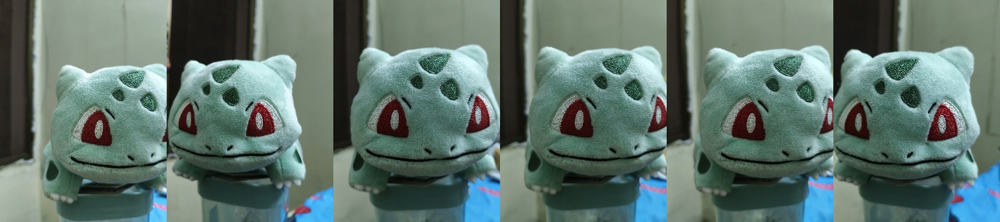
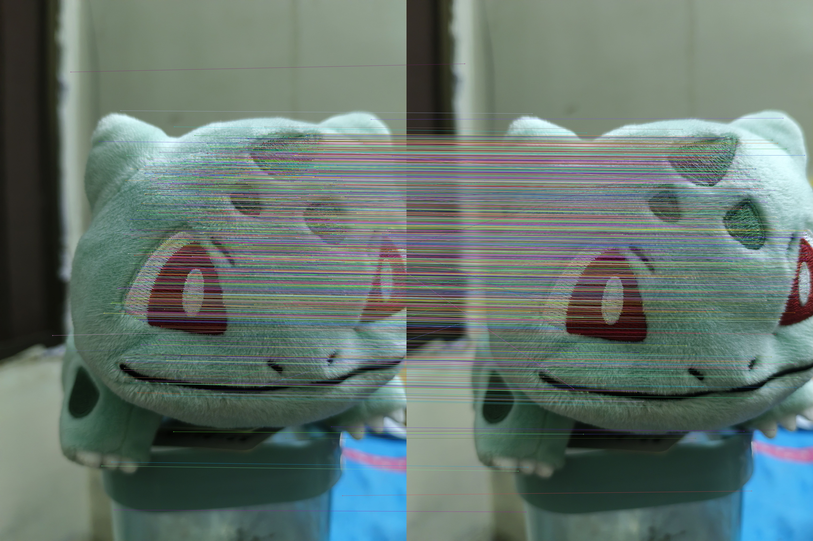
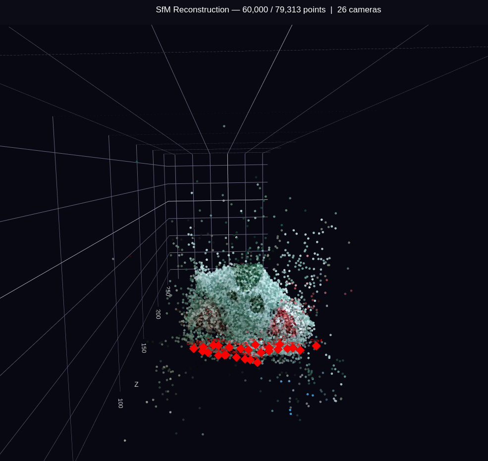
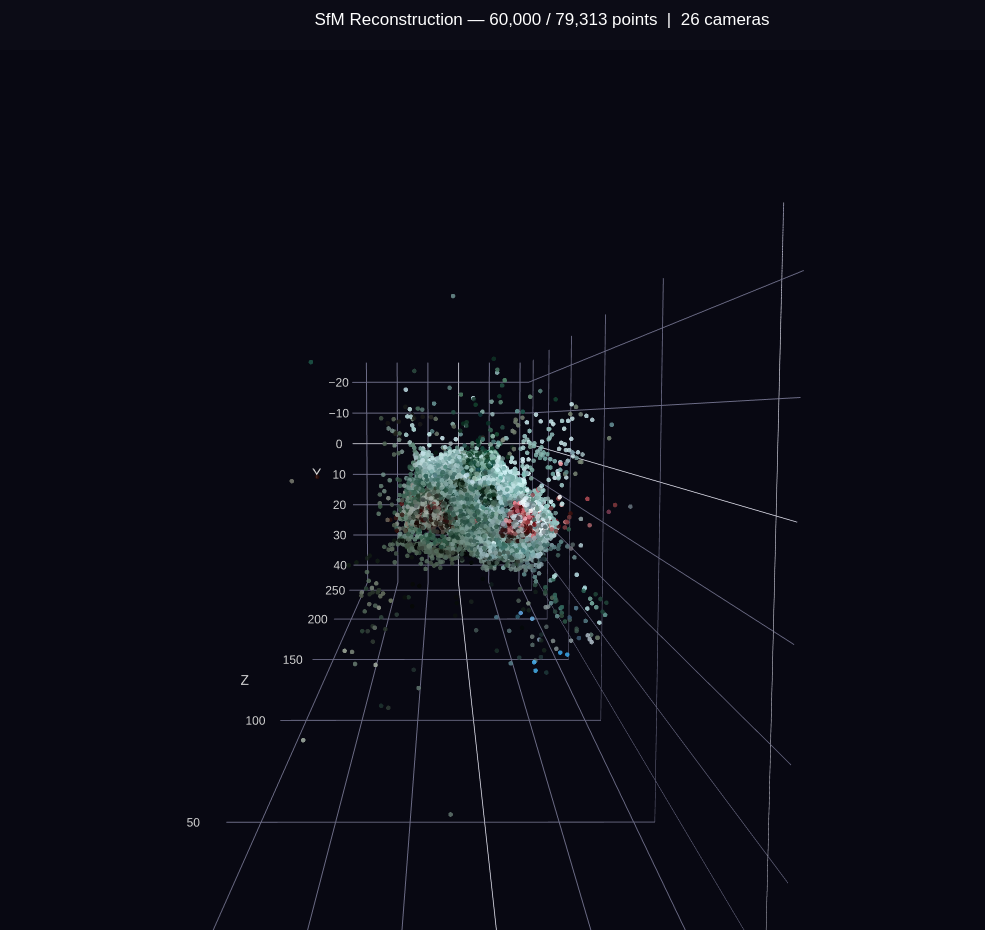

# Structure from Motion in Python

This project is part of a larger goal: creating 3D models of real-world objects from a single video captured while moving around the object.

This is a small learning project that reconstructs a sparse 3D point cloud from a set of photos of the same object.

The pipeline uses SIFT features to find the interesting points across images.
It estimates camera positions, triangulates 3D points, refines them with bundle
adjustment, and exports a coloured point cloud.

## Pipeline

```text
images → SIFT features → feature matching → RANSAC
       → camera pose → triangulation → bundle adjustment → point cloud
```

## Setup

```bash
python -m venv venv
source venv/bin/activate
pip install -r requirements.txt
```

## Run

Put images of one object in a folder, then run:

```bash
python main.py --images data/Bulbasaur3 --output output_bulbasaur3_debug --cpu_cores 2
```

Using fewer CPU workers is recommended for large photos because SIFT can use a
lot of memory.

## Output

Each run creates:

- `reconstruction.ply` — coloured sparse point cloud
- `reconstruction_final.png` — static preview
- `reconstruction_viewer.html` — interactive browser viewer
- `cameras.npz` — estimated camera centres

## Results

### Input images



### Seed-pair feature matches

The lines show SIFT features matched between the two images selected to
start the reconstruction.



### Sparse reconstruction with camera positions



### Coloured sparse point cloud



## Test

```bash
python -m unittest -v test_sfm_regressions.py
```

This is a sparse SfM project, not a dense mesh reconstruction pipeline.

## Detailed pipeline

1. **Load images** in filename order.
2. **Detect SIFT keypoints and descriptors** for every image. Keypoints are
   distinctive visual locations; descriptors are numerical descriptions of them.
3. **Match descriptors with FLANN**. Lowe's ratio test rejects ambiguous nearest
   neighbour matches.
4. **Choose a seed pair** from nearby image pairs with enough matches. The best
   candidate is selected by how many geometrically valid 3D points it produces.
5. **Estimate the fundamental matrix with RANSAC** to reject incorrect matches,
   then convert it to an essential matrix using the camera calibration matrix.
6. **Recover the two seed-camera poses** and triangulate their matching pixels
   into initial 3D points. Points must be in front of both cameras, reproject
   accurately, and have enough viewing-angle separation.
7. **Register each remaining image with PnP** using known 3D points that match
   features in the new image.
8. **Link existing tracks and triangulate new points** between the new camera
   and registered cameras.
9. **Run bundle adjustment** to jointly refine camera poses and 3D points by
   reducing reprojection error.
10. **Filter weak points**, sample their RGB colours from the input photos, and
    export the final sparse point cloud and visualisations.

## Camera calibration

The current camera intrinsic matrix (`K`) in `config.py` is estimated for the
camera and image resolution used in this project. If you use images captured
with a different camera, lens, or resolution, update `K` with that camera's
focal length and principal point for better reconstruction results.
